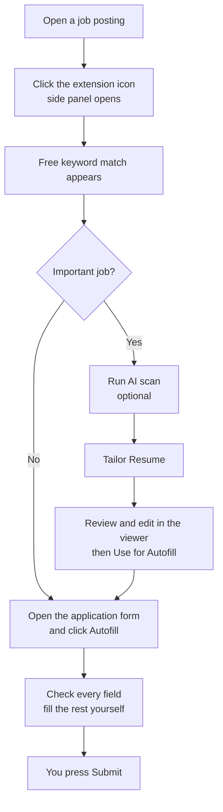
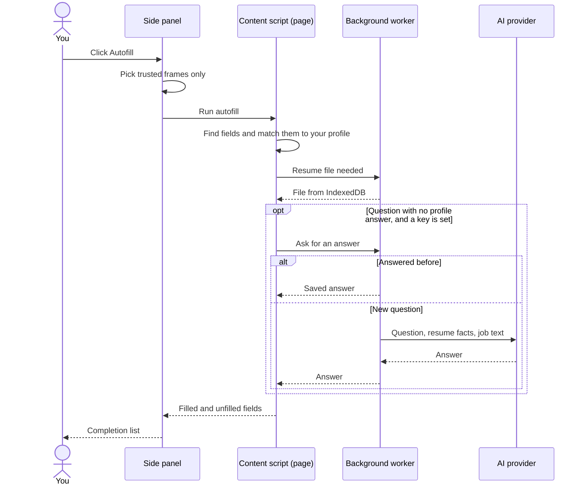
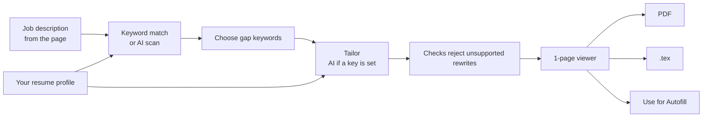
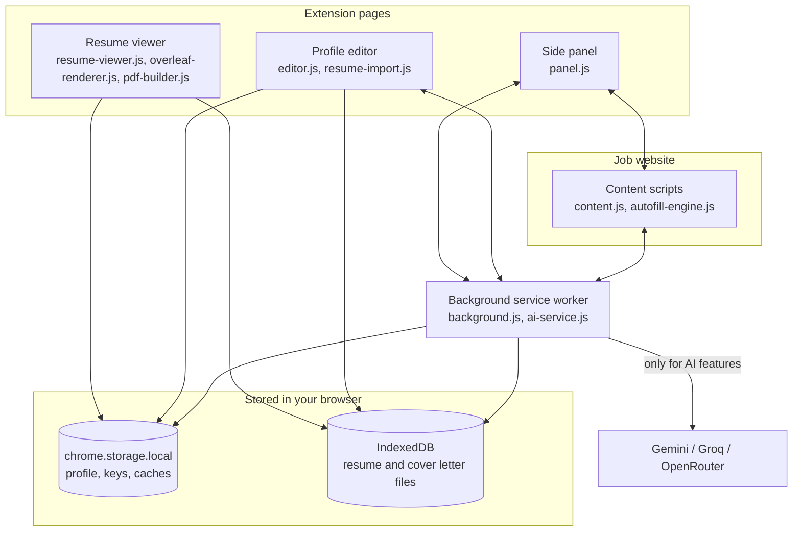

# Auto Job Resume Tailor

A Chrome extension that fills job application forms for you and builds a 1-page resume tailored to each job description. Upload your resume once, then apply faster.

Plain JavaScript, Manifest V3, no build step, no server.

## Contents

- [Features](#features)
- [Install](#install)
- [Get a free API key](#get-a-free-api-key)
- [First-time setup](#first-time-setup)
- [How to apply to a job](#how-to-apply-to-a-job)
- [How it works](#how-it-works)
- [Architecture](#architecture)
- [Privacy](#privacy)
- [Troubleshooting](#troubleshooting)
- [Limitations](#limitations)

## Features

| Feature | What it does | Needs an API key? |
|---|---|---|
| Resume import | Reads your PDF, DOCX or pasted text into an editable profile | No (AI reads unusual layouts better) |
| Autofill | Fills contact, work, education, skills and preference fields, including many custom dropdowns | No |
| Keyword match | Shows which job keywords your resume has and which are missing | No |
| AI scan | Deeper comparison of your resume with the job, on a button click | Yes |
| Tailor resume | Builds a 1-page resume for the job | No for Skills and Summary, Yes to reword bullets |
| Cover letter | Writes a short cover letter from your profile and the job | Yes |
| Screening answers | Suggests answers to application questions | Yes |
| Export | PDF, `.tex` (Overleaf), and "Use for Autofill" | No |

## Install

You need Google Chrome 116 or newer.

1. Download the code. Either clone it:

   ```bash
   git clone https://github.com/77sauravkr/Resume_Tailor_Extension.git
   ```

   or use **Code → Download ZIP** on GitHub and unzip it.
2. Open `chrome://extensions` in Chrome.
3. Turn on **Developer mode** (top right).
4. Click **Load unpacked** and select the `Resume_Tailor_Extension` folder.
5. Pin the extension from the puzzle icon so it is easy to open.

To update later, pull the new code (or download it again) and click **Reload** on the extension card.

## Get a free API key

A key is optional, but it unlocks the AI features. One provider is enough. Adding two or three gives you a backup when one hits its limit.

| Provider | Get your key here | Key usually starts with |
|---|---|---|
| **Groq** | **https://console.groq.com/keys** | `gsk_` |
| Google Gemini | https://aistudio.google.com/apikey | `AIza` |
| OpenRouter | https://openrouter.ai/keys | `sk-or-v1-` |

**Groq, step by step**

1. Open https://console.groq.com/keys and sign in.
2. Click **Create API Key** and give it a name.
3. Copy the key right away. It is shown only once.
4. In the extension, click ⚙ (Settings), paste it under **Groq API keys**.
5. Set **Preferred engine** to Groq if you want it used first.
6. Click **Save keys**, then **Test**.

Free tiers have rate limits that the provider can change. Check their website for current limits. Never share your key or commit it to a repository.

## First-time setup

The setup page opens after installation. You can reopen it any time with ⚙ in the side panel.

1. **Import your resume** (PDF or DOCX, up to 10 MB).
2. **Check every section.** Fix anything read wrongly, especially company names, dates and locations.
3. **Fill what a resume does not contain:** country, city, work authorization, visa sponsorship, notice period, expected salary.
4. **Save.**

Check the **Equal employment** and **Preferences** answers carefully. Some have defaults (for example sponsorship is "No") that may not be true for you.

## How to apply to a job



The extension never submits an application. You do.

**Tips**

- Click an item in the **Completion** list to jump to that field on the page.
- In the viewer, click any text to edit it. Edits save automatically.
- **Compare Changes** shows what tailoring changed.
- **Safe** mode adds only skills your resume supports or that are quick to learn. **All** adds every keyword, so use it only for skills you really have.
- To save API calls, use **Run AI scan**, **Tailor** and cover letters only for jobs you care about.

## How it works

### Autofill



### Resume tailoring



## Architecture



### Files

| File | Role |
|---|---|
| `manifest.json` | Extension configuration and permissions |
| `background.js` | Handles AI actions, caching and opening pages |
| `ai-service.js` | Providers, key fallback, rate-limit handling, tailoring rules |
| `content.js` | Reads job details from the page and starts autofill |
| `autofill-engine.js` | Detects and fills form fields |
| `autofill-data.js` | Profile structure and the trusted job-system list (`ATS_HOSTS`) |
| `panel.html` / `panel.js` | Side panel |
| `editor.html` / `editor.js` | Profile and settings editor |
| `resume-import.js` | PDF, DOCX and text parsing |
| `resume-viewer.html` / `resume-viewer.js` | View, edit, compare and export the resume |
| `overleaf-renderer.js` | Resume layout and LaTeX code |
| `pdf-builder.js` | Builds the PDF used by "Use for Autofill" |
| `doc-storage.js` | IndexedDB file storage |
| `profile-defaults.js` | Default AI settings |
| `lib/` | pdf.js 3.11.174 (Apache-2.0) |

## Privacy

- Your profile, API keys and files are stored in your own browser. The project has no server.
- Storage is **not encrypted**. This includes API keys and the optional sign-up password. Do not reuse an important password there.
- When you use an AI feature, resume text, job text and the question are **sent to the AI provider you chose**. Importing a resume with a key set sends the resume text too. Read that provider's data policy.
- Autofill runs in the page, its subdomains and known job-system frames, not in other embedded frames such as ads.
- Identity and banking questions (such as SSN, Aadhaar, PAN, date of birth) are not sent to AI for answers.
- The extension asks for access to all sites so it can read job pages and fill forms.

## Troubleshooting

| Problem | What to try |
|---|---|
| `401 Invalid API Key` or `API key not valid` | Create a new key, paste it again in Settings, click **Test** |
| `429` or rate limit | Wait a little, add a second provider, use AI features less often |
| "Could not reach this page" | Reload the job tab. Chrome's own pages and the Web Store cannot be filled |
| No job detected | Click **Re-scan page**, or paste the job description into the panel |
| Resume read wrongly | Fix it in the editor, or import a DOCX or text version |
| Fields left empty | Add the missing answer in the editor, or fill it by hand |
| A form inside a frame is not filled | Its host may be missing from `ATS_HOSTS` in `autofill-data.js` |

## Limitations

- Websites differ. Autofill will miss some fields, so always review before submitting.
- Workday forms and custom widgets are not fully verified.
- Scanned (image-only) resumes and old `.doc` files cannot be read.
- AI text can be wrong. Check that every line of your resume and every answer is true.

## Testing

Manual test steps are in [TEST_PLAN.md](TEST_PLAN.md). After changing code, click **Reload** on `chrome://extensions` and reload open job tabs.
